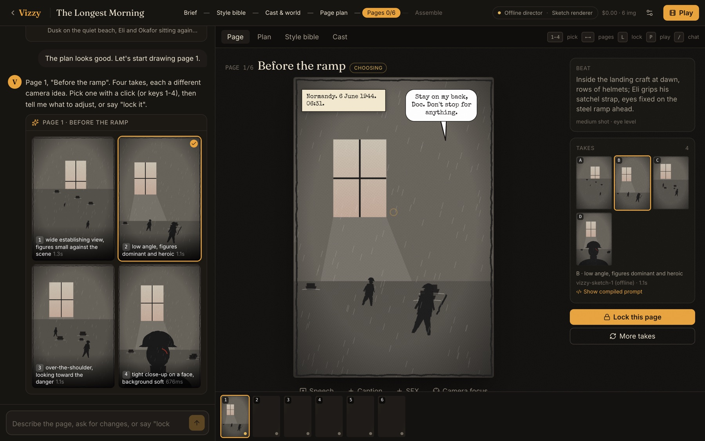
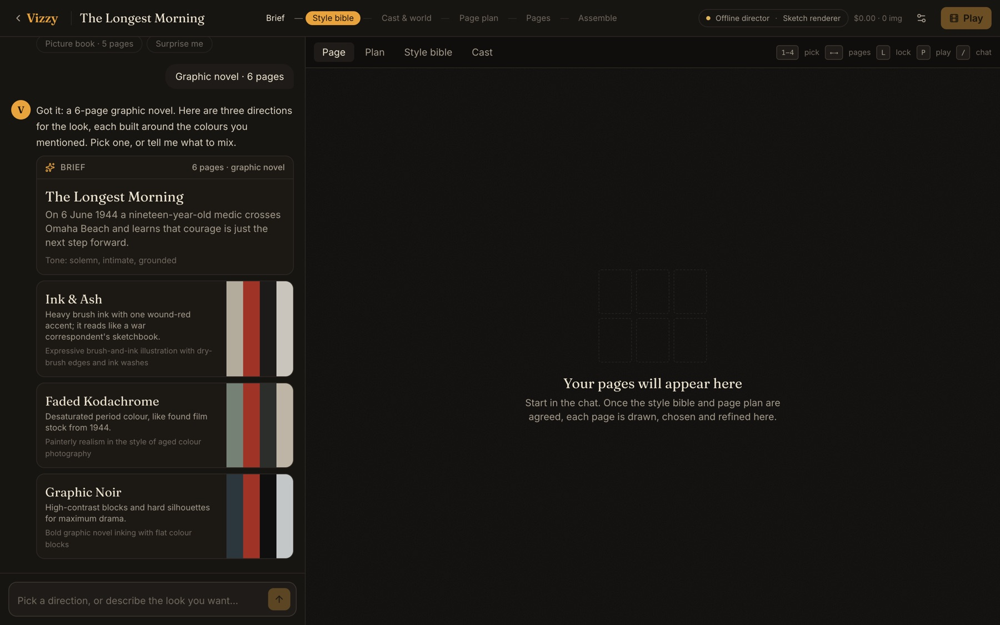
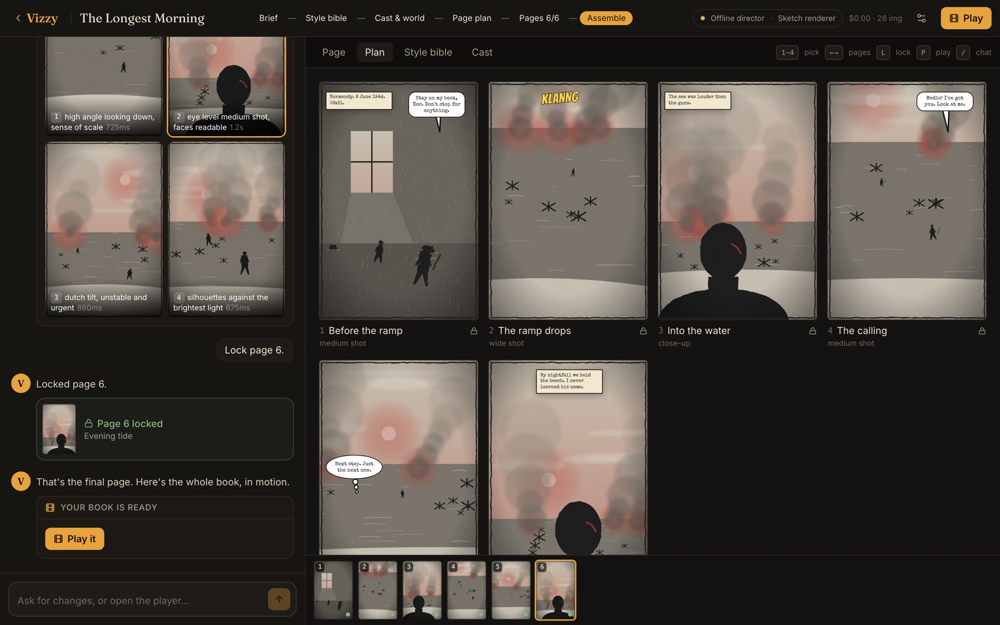
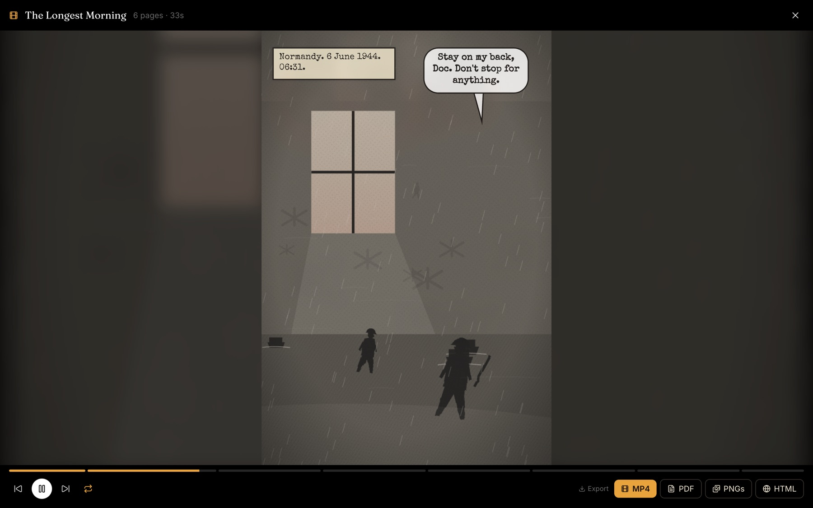
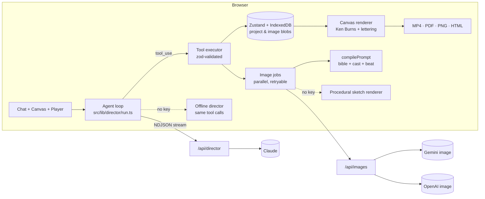

# Vizzy

**Make a graphic novel, picture book or film storyboard by chatting with an AI creative director, one page at a time.**

You describe a story. Vizzy helps you settle on a visual style and the main characters, then plans the pages. For each page it draws a few different takes, and you pick one, refine it in chat and lock it. At the end Vizzy assembles the pages into a slideshow that loops. You can export it as an MP4, a PDF, a ZIP of PNGs or a single offline HTML file.



> **It runs with no API keys.** Clone the repo, run `npm run dev` and go through the whole flow. With no keys, a scripted offline director and a procedural "sketch" renderer stand in for Claude and the image models. Add keys and the same UI drives Claude and Gemini / OpenAI instead.

---

## The flow

| Phase | What happens |
|---|---|
| **Brief** | Paste a script, some notes or a single line. Vizzy reads it and asks only what's missing (format, length, tone), using quick-reply chips. |
| **Style bible** | Vizzy offers three different visual directions, each with a palette, lighting, texture and mood. Colours you named are worked into all three. The one you pick becomes a versioned **style bible**. |
| **Cast & world** | Each main character gets a fixed visual description and an optional **reference sheet**. Both are sent with every page so faces and costumes stay consistent. |
| **Page plan** | The story is split into an arc of pages. Each page has a beat, a shot type and angle, the cast in it, and its lettering. You can edit the plan in chat ("make page 3 a close-up") or reorder pages by dragging them in the filmstrip. |
| **Pages** | For each page Vizzy renders 3–4 takes, each a deliberately different camera idea (not a random re-roll). You **select** one (click or keys `1–4`), **refine** it ("more smoke, darker") and **lock** it (`L`). |
| **Assemble** | A full-screen player moves slowly across each page toward its focal point, crossfades between pages, and pops in captions and balloons on cue. Export as **MP4**, **PDF**, **PNGs** or a self-contained **HTML** player. |

<p>
  
  
</p>



---

## Design decisions

**1. The director proposes; the app executes.**
Claude never edits project state directly. It calls one of 17 typed tools (`propose_style_directions`, `generate_page_options`, `refine_option`, `lock_page`, …). The browser checks each call against a zod schema and applies it to the local project. It then shows a rich card in the chat and sends a short `tool_result` back. A call that fails validation comes back as `is_error`, and Claude corrects itself. The same zod schemas generate the JSON Schema sent to the API, so the two can never drift apart.

**2. Prompts are compiled by code, not written by the model.**
Claude writes the *beat*: what happens and how the camera sees it. [`compilePrompt()`](src/lib/prompt.ts) wraps it deterministically in the style bible, the palette hex codes, the characters' fixed descriptions, the shot, the composition constraints and a `[NEVER]` block. That gives pages a consistent look, makes debugging possible, and lets you inspect it: every take has a **"Show compiled prompt"** drawer listing the exact text, the reference images, the model, the latency and the cost.

**3. Consistency comes from reference images, not luck.**
Character reference sheets, plus the first locked page used as a *style anchor*, go to the image model as labelled visual references. Refinement is an **image edit** of the selected take, so the composition is kept instead of being regenerated from scratch.

**4. Lettering is composited, never baked into the image.**
Image models garble text, and editing a line of dialogue shouldn't cost a re-render. Captions, speech and thought balloons, and SFX are an HTML layer you can edit and drag. The canvas renderer draws the *same* layout for the player and every export. Prompts reserve negative space for the lettering and forbid text inside the image.

**5. The agent loop runs in the browser.**
`/api/director` is a thin streaming proxy around a single Claude turn (NDJSON). The client runs the loop: stream text into the chat bubble, execute the tool calls locally, send the results back, repeat. All state lives in IndexedDB, so the server stays stateless and can hold API keys without holding user data.

**6. The chat never blocks on image generation.**
`generate_page_options` returns immediately. Up to three takes render in parallel, appear as they finish, and can each be retried. Clicks on the canvas (select a take, edit lettering, reorder pages) are recorded as `<ui_events>` and sent with your next message, so the director stays in sync without spending a model turn on every click.

**7. Each turn carries a compact snapshot instead of relying on the model's memory.**
Every user turn includes a short `<project_state>` text snapshot: the phase, the bible, the cast and every page's status and options. Images are never put into the director's context. The system prompt and tool list form a cached prefix. The transcript is append-only and thinking blocks are passed back unchanged.

---

## Architecture



| Path | What lives there |
|---|---|
| `src/lib/director/tools.ts` | Zod schemas for the 17 director tools, converted to JSON Schema for the API |
| `src/lib/director/system.ts` | System prompt and the per-turn project snapshot |
| `src/lib/director/run.ts` | Client agent loop, NDJSON stream reader, rollback on failure, cost meter |
| `src/lib/director/execute.ts` | Applies a validated tool call to the project and returns cards plus a result |
| `src/lib/director/demo.ts` | Offline director: a deterministic state machine that emits the same tool calls |
| `src/lib/prompt.ts` | Deterministic prompt compiler and reference-image selection |
| `src/lib/images.ts` | Parallel image jobs, refinements, retries, reference sheets |
| `src/lib/art/sketch.ts` | Seeded SVG "storyboard sketch" renderer for keyless mode |
| `src/lib/timeline.ts`, `render.ts` | One `renderFrame(t)` shared by the live player and the MP4 encoder |
| `src/lib/export.ts` | WebCodecs MP4 (mediabunny, WebM fallback), jsPDF, JSZip, standalone HTML |
| `src/app/api/*` | Streaming director proxy; Gemini / OpenAI image generation and editing with retry |

---

## Running it

```bash
npm install
npm run dev        # http://localhost:3000
```

All of the following are optional (see `.env.example`):

```bash
ANTHROPIC_API_KEY=...   # Claude director (default model: claude-opus-5-5, effort: low)
GEMINI_API_KEY=...      # images: gemini-nano-banana-2.1 (preferred)
OPENAI_API_KEY=...      # images: gpt-image-2
```

Keys can also be pasted into **Settings** inside the app. They stay in that browser's local storage and are sent with each request; the server never stores them. The header pill shows which director and image provider are active, and **Settings** switches between them.

```bash
npm test           # Vitest: prompt compiler, tool schemas, offline director
npm run lint
npm run build
```

### Keyboard

`1–4` pick a take · `L` lock the page · `←/→` move between pages · `P` play · `/` focus the chat · `Space` pause the player · `Esc` close the player

---

## What I'd build next

- **Continuity check on lock:** a Claude vision pass that compares the locked page with the reference sheets ("Eli's red-cross armband is missing").
- **"Vizzy's pick":** have Claude rank the takes with a short reason, shown as a badge.
- **Stale-page detection:** when the bible or a character changes version, flag locked pages built with the old version and offer to re-render them with the old image as the composition reference.
- **Multi-panel page layouts**, plus music and narration in the exported film.
- **Shareable hosted links** (requires storage and auth; the HTML export covers offline sharing for now).
